# SprintMind: Project Workflow Document

| Field | Value |
|---|---|
| **Product** | SprintMind |
| **Version** | 1.0 |
| **Document type** | Project Workflow |
| **Related docs** | PRD, System Architecture, UI Design |

---

## 1. Purpose

This document covers two kinds of workflow:

- **Part A: Product workflows**: how users move through SprintMind (issue lifecycle, sprint lifecycle, AI flow, roles)
- **Part B: Development workflow**: how the team builds SprintMind (phases, sprints, Git, testing, release)

---

# PART A: PRODUCT WORKFLOWS

## 2. End-to-End User Journey

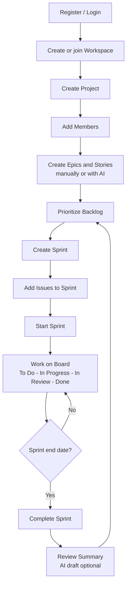

In words:
1. The user registers and logs in.
2. They create a workspace and a project, then invite members.
3. The Product Owner writes epics and stories (or generates drafts with AI).
4. The backlog is ordered by priority.
5. The Project Manager creates a sprint and adds issues.
6. The sprint starts and the team works on the board.
7. At the end, the sprint is completed and a summary is reviewed.
8. Unfinished work returns to the backlog and the cycle repeats.

---

## 3. Onboarding Workflow

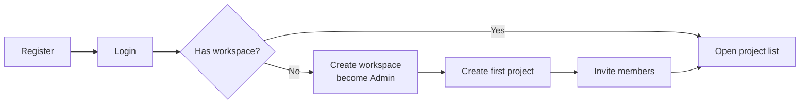

| Step | Actor | Result |
|---|---|---|
| 1 | New user | Account created |
| 2 | New user | Workspace created, user is Admin |
| 3 | Admin / Manager | First project created |
| 4 | Admin | Members invited with roles |
| 5 | Invited user | Registers or logs in and sees the workspace |

---

## 4. Issue Lifecycle

### 4.1 Status Flow

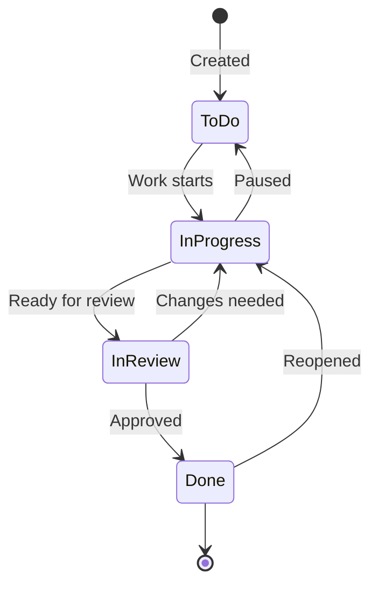

| Status | Meaning |
|---|---|
| To Do | Not started |
| In Progress | Being worked on |
| In Review | Finished, waiting for review or testing |
| Done | Accepted and complete |

Moves are made by dragging a card on the board or by changing the status field in Issue Detail. Any status change is written to the activity log.

### 4.2 Issue Hierarchy
```
Epic
 └── Story
      ├── Task
      └── Bug
```
- An epic groups related stories.
- A story is a user-facing requirement.
- Tasks and bugs are the work items under a story. Bugs may also exist alone.

### 4.3 Create Issue Workflow
1. User opens Backlog and clicks **Create Issue**.
2. Fills in type, title, and optional details.
3. Server validates and assigns the next key (for example `SM-15`).
4. Issue appears in the backlog (no sprint) with status **To Do**.
5. Activity log records "created".

---

## 5. Backlog and Sprint Lifecycle

### 5.1 Sprint Status Flow

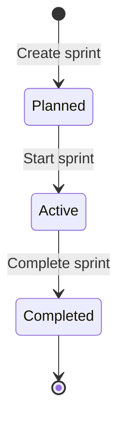

### 5.2 Sprint Rules
| Rule | Detail |
|---|---|
| One active sprint | Only one sprint per project can be active at a time |
| Required fields | Name, start date, end date; goal recommended |
| Adding issues | Issues come from the backlog or another planned sprint |
| Starting | Sprint must contain at least one issue |
| Completing | The user chooses where unfinished issues go: backlog or next sprint |
| Done issues | Stay attached to the completed sprint for reporting |

### 5.3 Sprint Planning Workflow
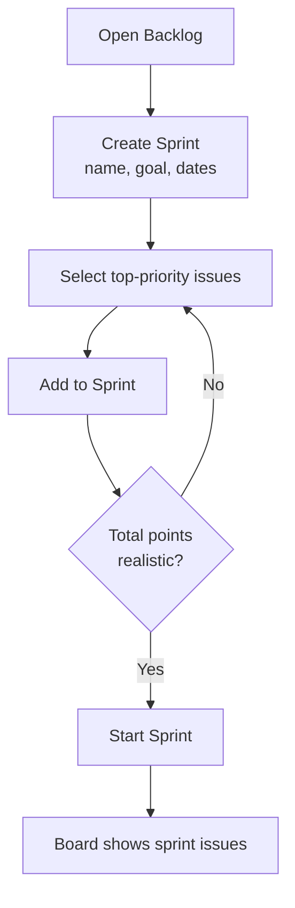

### 5.4 Sprint Completion Workflow
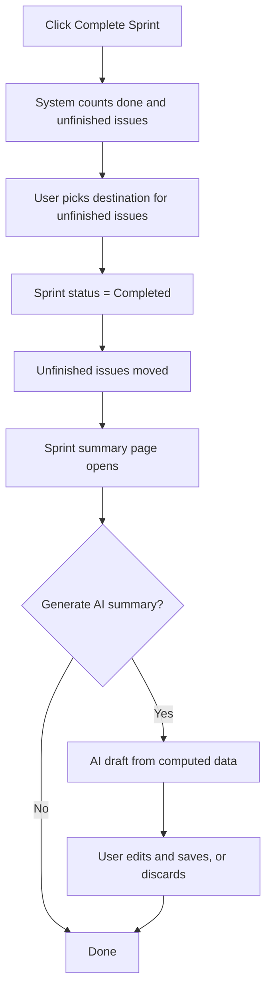

---

## 6. Kanban Workflow

| Project type | Board shows | Typical flow |
|---|---|---|
| **Scrum** | Issues in the **active sprint** | Plan sprint, work through columns, complete sprint |
| **Kanban** | **All non-archived issues** | Continuous flow; pull from To Do whenever capacity allows |

Board interaction:
1. Open **Board**.
2. Drag a card to another column.
3. The frontend updates the card immediately (optimistic update).
4. `PATCH /issues/{id}/move/` saves the change.
5. If the server rejects it (for example, no permission), the card returns to its old column and an error toast appears.

---

## 7. AI Workflow

### 7.1 General Pattern (all AI features)

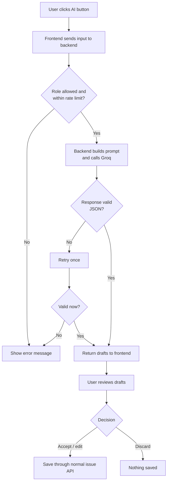

**Golden rule:** nothing from AI is saved until the user approves it.

### 7.2 Feature Workflows

| Feature | Input | AI output (draft) | User action | Saved as |
|---|---|---|---|---|
| Requirements to stories | Pasted requirements text | List of stories with description and points | Select, edit, accept | New story issues |
| Task breakdown | An existing story | List of tasks | Select, edit, accept | New task issues linked to the story |
| Acceptance criteria | An existing story | Bullet list of criteria | Edit, accept | Story's acceptance criteria field |
| Bug analysis | Bug title and description | Clearer summary, suggested severity, missing info | Apply or discard | Updated bug description or priority |
| Sprint summary | Computed sprint numbers and issue titles | Short written summary | Edit and save | Sprint summary field |

### 7.3 AI Failure Handling
| Failure | What the user sees | System action |
|---|---|---|
| Timeout (over 30 s) | "AI took too long. Try again." | Log `timeout` |
| Groq rate limit | "AI is busy. Try again shortly." | Log `error`, no retry loop |
| Invalid output | "Could not read AI response. Try again." | Retry once, then log |
| User rate limit | "Too many AI requests. Try again later." | Return `429` |
| Groq down | "AI is unavailable. You can create issues manually." | Core app unaffected |

---

## 8. Role-Based Workflows

| Role | Typical daily workflow |
|---|---|
| **Admin** | Manage members and roles, create projects, oversee workspace |
| **Project Manager** | Plan sprints, assign work, monitor dashboard, complete sprints |
| **Product Owner** (Manager or Developer role in V1) | Write stories, prioritize backlog, use AI to draft stories |
| **Developer** | Check assigned tasks, move cards, comment, update status |
| **Viewer** | Read dashboard, board, and reports |

> V1 has four system roles (Admin, Manager, Developer, Viewer). "Product Owner" is a team responsibility, held by someone with the Manager or Developer role.

### Daily Developer Flow
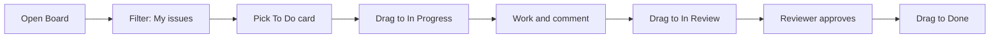

---

## 9. Dashboard Data Workflow

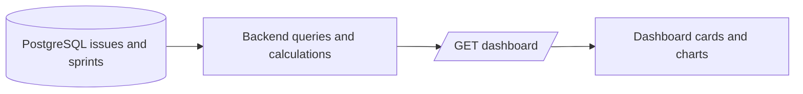

- Every number is calculated by the backend from stored records.
- AI is **never** a source for metrics.
- Overdue means `due_date < today` and `status != done`.

---

# PART B: DEVELOPMENT WORKFLOW

## 10. Development Methodology

SprintMind is built with the same practice it supports: **Scrum with 1 or 2-week sprints**.

| Ceremony | Frequency | Purpose |
|---|---|---|
| Sprint planning | Start of sprint | Choose the sprint scope |
| Daily check-in | Daily (short) | Share progress and blockers |
| Sprint review / demo | End of sprint | Show working features |
| Retrospective | End of sprint | Improve the process |
| Backlog refinement | Mid-sprint | Clarify upcoming stories |

---

## 11. Project Phases

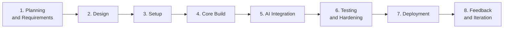

| Phase | Activities | Output |
|---|---|---|
| **1. Planning and Requirements** | Abstract, PRD, scope, roles | Approved PRD |
| **2. Design** | Architecture, database, API, UI wireframes | Architecture and UI documents |
| **3. Setup** | Repos, environments, Neon project, CI, base React and Django apps | Working skeleton |
| **4. Core Build** | Auth, workspaces, projects, issues, backlog, sprints, board, dashboard | Working app without AI |
| **5. AI Integration** | Groq client, prompts, validation, review UI | AI features working |
| **6. Testing and Hardening** | Unit, API, UI, permission, and AI tests; bug fixing; security review | Test report |
| **7. Deployment** | Production setup, migrations, environment variables, smoke tests | Live V1.0 |
| **8. Feedback and Iteration** | Collect user feedback, fix issues, plan V1.1 | Updated backlog |

---

## 12. Suggested Timeline (10 Weeks, 5 Sprints of 2 Weeks)

| Sprint | Weeks | Goal | Main deliverables |
|---|---|---|---|
| **Sprint 0** | 1 | Foundation | Docs approved, repos, Neon DB, project skeletons, CI, ER design |
| **Sprint 1** | 2 to 3 | Accounts and projects | Register/login (JWT), workspaces, members and roles, projects, base layout |
| **Sprint 2** | 4 to 5 | Issues and backlog | Issue CRUD, keys, hierarchy, backlog list, filters, reorder |
| **Sprint 3** | 6 to 7 | Sprints and board | Sprint create/start/complete, Kanban board with drag, dashboard |
| **Sprint 4** | 8 to 9 | AI features | Groq integration, stories, tasks, criteria, bug analysis, sprint summary, review UI |
| **Sprint 5** | 10 | Release | Testing, bug fixes, security checks, deployment, user guide |

> Adjust the dates to your calendar. If time is tight, move comments, activity log, and bug analysis to V1.1 (as in the PRD release plan).

### Gantt View
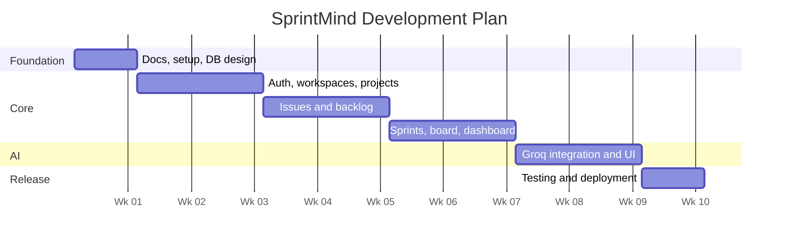
(Dates are placeholders; change the start date to your own.)

---

## 13. Sprint Backlog Seed (SprintMind's Own Stories)

| Epic | Stories |
|---|---|
| **Accounts** | Register; log in; refresh token; edit profile; change password |
| **Workspaces** | Create workspace; invite member; change role; remove member |
| **Projects** | Create project; edit; archive; set methodology |
| **Issues** | Create issue; edit; delete; link to epic/story; set priority, points, assignee, due date |
| **Backlog** | View backlog; reorder; filter; move to sprint |
| **Sprints** | Create sprint; start; complete; handle unfinished issues; sprint progress |
| **Board** | Show columns; drag to change status; filter by assignee |
| **Dashboard** | Status counts; completion %; overdue list; sprint progress bar |
| **AI** | Stories from requirements; task suggestions; acceptance criteria; bug analysis; sprint summary; review panel; error handling |
| **Quality** | Permission tests; AI mock tests; E2E smoke test; deployment; user guide |

---

## 14. Team Responsibilities (Adjust to Team Size)

| Area | Responsibilities |
|---|---|
| **Frontend** | React pages, components, API integration, board drag-and-drop, AI review UI |
| **Backend** | Models, serializers, views, permissions, services, migrations |
| **AI integration** | Groq client, prompts, output validation, rate limits, tests |
| **QA / Testing** | Test plan, test cases, regression runs, bug log |
| **Documentation** | Keep PRD, architecture, API docs, and user guide current |

For a solo developer, follow the same phases and cover each area in turn.

---

## 15. Git and Code Workflow

### 15.1 Repository Layout
```
sprintmind/
├── backend/
├── frontend/
├── docs/          # the four .md documents
└── README.md
```
(One monorepo is recommended for a small team.)

### 15.2 Branching
| Branch | Use |
|---|---|
| `main` | Always deployable; protected |
| `develop` | Integration branch (optional for small teams) |
| `feature/<ticket>-<name>` | One feature per branch, e.g. `feature/SM-12-board-drag` |
| `fix/<ticket>-<name>` | Bug fixes |

### 15.3 Commit Message Format
```
<type>: <short summary>
```
Types: `feat`, `fix`, `docs`, `refactor`, `test`, `chore`.
Example: `feat: add sprint start endpoint`

### 15.4 Pull Request Flow
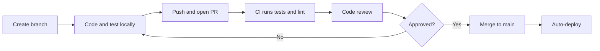

---

## 16. Definition of Ready and Definition of Done

### Definition of Ready (a story can enter a sprint)
- Clear title and description
- Acceptance criteria written
- Estimated in story points
- Dependencies identified
- UI reference available (if it affects the UI)

### Definition of Done (a story is complete)
- Code written and reviewed
- Unit and API tests written and passing
- Permissions checked for each role
- UI matches the UI Design document
- No console errors or lint errors
- API documentation updated
- Works on the staging environment
- Product owner accepted

---

## 17. Testing Workflow

| Stage | When | What |
|---|---|---|
| Unit tests | During development | Services, calculations, permissions |
| API tests | Each endpoint merged | Every endpoint for every role |
| AI tests | Each AI feature | Mock Groq: valid, malformed, timeout, rate-limited |
| UI tests | Before sprint review | Key flows in the browser |
| Regression | End of each sprint | Re-run all tests |
| UAT | Before release | Real users try the main scenarios |

### Key Test Scenarios
1. Register, log in, log out, refresh token
2. Each role attempts permitted and forbidden actions
3. Create project, then issues of each type with correct keys (`SM-1`, `SM-2`)
4. Start a second sprint while one is active, which must be rejected
5. Complete a sprint with unfinished issues, which must go to the chosen destination
6. Drag a card; verify status and activity log
7. Dashboard numbers equal database counts
8. AI generates drafts; nothing is saved until accepted
9. AI fails or times out; the rest of the app still works
10. A user cannot see another workspace's data

---

## 18. Release and Deployment Workflow

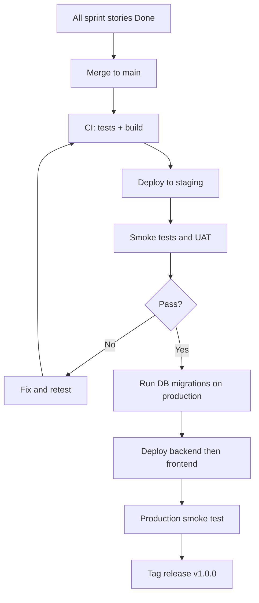

### Release Checklist
- [ ] All Must requirements implemented
- [ ] Tests passing
- [ ] `DEBUG=False`, secrets set in the host, not in code
- [ ] HTTPS and CORS configured
- [ ] Neon pooled connection and backups enabled
- [ ] Groq key and rate limits configured
- [ ] Health endpoint returns OK
- [ ] User guide and README updated
- [ ] Release tagged

---

## 19. Bug and Change Management

### Bug Workflow
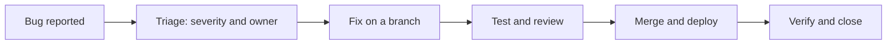

| Severity | Meaning | Response |
|---|---|---|
| Critical | App unusable, data loss, security hole | Fix immediately |
| High | Core feature broken | Fix in current sprint |
| Medium | Feature partly broken, workaround exists | Next sprint |
| Low | Cosmetic | Backlog |

### Change Requests
New requests go to the backlog, are estimated, and are prioritized at the next planning session. Scope changes inside a running sprint need the Project Manager's approval.

---

## 20. Risk Monitoring During Development

| Risk | Early warning | Action |
|---|---|---|
| Scope creep | Sprint scope keeps growing | Freeze sprint scope; add extras to backlog |
| AI quality problems | Many drafts rejected | Improve prompts; tighten output schema |
| Groq limits | Frequent 429 errors | Lower per-user limits; add caching or queueing |
| Neon connection issues | Timeouts on first request | Use pooled string; add retry |
| Permission bugs | Failing role tests | Add a test for every endpoint x role pair |
| Schedule slip | Velocity below plan | Move Should/Could items to V1.1 |

---

## 21. Documentation Workflow

| Document | Owner | Updated when |
|---|---|---|
| PRD | Product Owner | Scope or requirement changes |
| System Architecture | Tech lead | Design or stack changes |
| UI Design | Frontend lead | Screens change |
| Project Workflow | Project Manager | Process changes |
| API docs (OpenAPI) | Backend | Auto-generated on each build |
| User guide | QA / Docs | Before each release |

Keep all documents in the `docs/` folder and update them in the same pull request as the related change.

---

## 22. Success Review After Release

Compare against the PRD success metrics:

| Metric | Target | How to measure |
|---|---|---|
| Time to first issue | Under 5 minutes | Observe 3 to 5 new users |
| AI suggestion acceptance | 40% or higher | Compare AI drafts shown vs. accepted |
| Core uptime | 99% or higher | Health check monitoring |
| Critical bugs | 0 | Bug log |
| User satisfaction | 4/5 or higher | Short survey |

Use the results to plan **V1.1**: comments, activity log, search, bug analysis, sprint summary polish.
