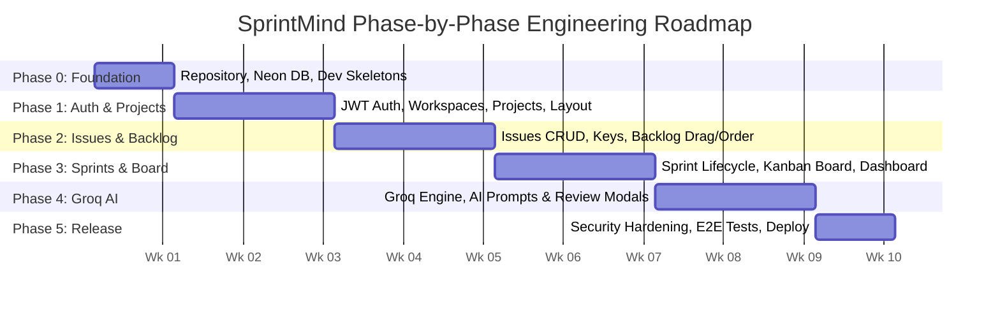

# SprintMind: Phase-by-Phase Implementation Plan

| Field | Value |
|---|---|
| **Product** | SprintMind: AI-Powered Agile Project Management System |
| **Version** | 1.0 |
| **Document type** | Phase-by-Phase Technical Implementation Plan |
| **Timeline** | 10 Weeks (5 Sprints of 2 Weeks each) |
| **Related docs** | [01_SprintMind_PRD.md](file:///c:/Users/Asus/Desktop/SprintMind/docs/01_SprintMind_PRD.md), [02_SprintMind_System_Architecture.md](file:///c:/Users/Asus/Desktop/SprintMind/docs/02_SprintMind_System_Architecture.md), [05_SprintMind_API_Specification.md](file:///c:/Users/Asus/Desktop/SprintMind/docs/05_SprintMind_API_Specification.md), [06_SprintMind_Test_Plan.md](file:///c:/Users/Asus/Desktop/SprintMind/docs/06_SprintMind_Test_Plan.md) |

---

## 1. Executive Summary & Delivery Strategy

This document defines the actionable, phase-by-phase engineering roadmap for delivering **SprintMind 1.0**. The implementation is structured into **6 iterative phases (Phase 0 through Phase 5)** following Agile Scrum methodology.

### 1.1 Guiding Principles
1. **Vertical Slice Architecture**: Deliver fully testable, integrated vertical slices (Database ➔ Serializer/Service ➔ API ➔ UI Component) in every phase.
2. **Deterministic Data Integrity**: Strict PostgreSQL foreign keys, row-level locks on counters, and SQL-computed metrics.
3. **Fail-Safe AI Isolation**: The Groq AI assistant acts purely as a drafting layer with zero automatic database writes. Non-AI features must remain 100% functional during AI outages.
4. **Enforced Security by Design**: RBAC is validated on the backend for every request. Multi-tenant workspace data leakage is prevented via mandatory queryset scoping.

---

## 2. Master Phase Timeline

| Phase | Milestone | Duration | Primary Deliverable |
|---|---|---|---|
| **Phase 0** | Foundation & Project Scaffolding | Week 1 | Verified repo, Django & Vite skeletons, Neon DB connected |
| **Phase 1** | Identity, Workspaces & Projects | Weeks 2–3 | Multi-tenant JWT auth, RBAC permissions, project management |
| **Phase 2** | Issue Tracking & Backlog | Weeks 4–5 | Full issue hierarchy, atomic keys, backlog prioritization |
| **Phase 3** | Sprints, Kanban Board & Dashboard | Weeks 6–7 | Sprint management, drag-and-drop board, live SQL analytics |
| **Phase 4** | Groq AI Planning Assistant | Weeks 8–9 | AI story drafting, task breakdown, criteria, bug triage, review UI |
| **Phase 5** | Hardening, Testing & Production Release | Week 10 | Security audits, CI test suite, live deployment on cloud |

---

## 3. Detailed Phase Breakdown

---

### Phase 0: Foundation, Tooling & Environment Setup (Sprint 0 · Week 1)

**Goal**: Establish the repository, developer tooling, database connection, and automated CI pipelines.

#### 0.1 Backend Infrastructure
- [x] Initialize Python 3.11 virtual environment and Django 5 project inside `backend/`.
- [x] Install dependencies: `djangorestframework`, `djangorestframework-simplejwt`, `django-cors-headers`, `psycopg[binary]`, `dj-database-url`, `python-dotenv`, `drf-spectacular`.
- [x] Configure `sprintmind/settings.py` for environment-driven settings (`DEBUG`, `SECRET_KEY`, `ALLOWED_HOSTS`, `DATABASE_URL`).
- [x] Connect to Neon PostgreSQL instance with SSL mode required; verify database connection.
- [x] Configure custom exception handler returning the standard JSON error envelope (`{ "error": { "code", "message" } }`).
- [x] Setup Swagger/OpenAPI generation via `drf-spectacular` at `/api/schema/swagger-ui/`.
- [x] Create `/api/v1/health/` endpoint verifying DB connectivity.

#### 0.2 Frontend Infrastructure
- [x] Initialize React 18 application using Vite in `frontend/`.
- [x] Install core libraries: `react-router-dom`, `@tanstack/react-query`, `axios`, `@hello-pangea/dnd`, `recharts`, `lucide-react`.
- [x] Create base directory layout: `api/`, `components/`, `features/`, `hooks/`, `layouts/`, `pages/`, `styles/`.
- [x] Configure Axios instance with base URL from `VITE_API_BASE_URL` and Bearer token interceptor.
- [x] Implement global design tokens in `index.css` (primary `#2563EB`, slate `#0F172A`, light gray `#F8FAFC`, AI purple `#7C3AED`, 6px corner radius).

#### 0.3 Quality & CI Pipeline
- [x] Setup GitHub Actions workflow running:
  - Backend: `flake8` linter, `pytest`
  - Frontend: `npm run lint`, `npm run build`
- **Phase 0 Exit Gate**: Both backend and frontend run locally; `GET /api/v1/health/` returns `200 OK`; Neon database tables migrate successfully.

---

### Phase 1: Authentication, Workspaces & Project Management (Sprint 1 · Weeks 2–3)

**Goal**: Deliver secure user registration, multi-tenant workspace management, role assignments, and project creation.

#### 1.1 Backend Implementation (`apps/accounts`, `apps/workspaces`, `apps/projects`)
- [x] **Custom User Model**: Email as username, hashed password, timestamps.
- [x] **JWT Auth Endpoints**:
  - `POST /api/v1/auth/register/` (returns user + tokens)
  - `POST /api/v1/auth/login/` (validates credentials, returns access & refresh tokens)
  - `POST /api/v1/auth/token/refresh/`
  - `POST /api/v1/auth/logout/` (blacklists refresh token)
  - `GET /api/v1/auth/me/` & `PATCH /api/v1/auth/me/`
- [x] **Workspace & Membership Models**:
  - `Workspace` (id, name, owner_id)
  - `WorkspaceMember` (workspace, user, role: `admin`, `manager`, `developer`, `viewer`)
  - Auto-assign creator as `admin`.
- [x] **RBAC Permission Classes**:
  - `IsWorkspaceMember`, `IsWorkspaceAdmin`, `CanManageProject`, `ReadOnlyForViewer`.
- [x] **Project Model & Endpoints**:
  - `Project` (workspace, name, key, description, methodology: `scrum`/`kanban`, `issue_counter`, `is_archived`).
  - Key uniqueness per workspace (e.g. `SM`).
  - `GET /api/v1/projects/`, `POST /api/v1/projects/`, `PATCH /api/v1/projects/{id}/`, `POST /api/v1/projects/{id}/archive/`.

#### 1.2 Frontend Implementation
- [x] **Authentication Pages**: `Login` and `Register` pages with field validations and error banners.
- [x] **Auth Context & State**: Persist access token in memory, refresh token rotation, redirect on 401.
- [x] **Application Shell (`AppLayout`)**:
  - Top bar: Workspace switcher, active project selector, user profile avatar.
  - Left sidebar: Navigation links (Dashboard, Backlog, Sprints, Board, Reports, Projects, Team).
- [x] **Project Management UI**:
  - Projects grid view with methodology pills (`Scrum` / `Kanban`).
  - `NewProjectModal` with name, key, and methodology selection.
- [x] **Team & Members UI (Admin)**:
  - Members table with role badges.
  - `InviteMemberModal` for adding users by email with assigned role.

#### 1.3 Phase 1 Testing Checkpoint
- [x] Pytest suite covering user registration, login, token refresh, and logout blacklist.
- [x] RBAC tests: Verify `Viewer` and `Developer` cannot create projects (`403 Forbidden`).
- [x] Tenant isolation test: Verify User from Workspace A cannot access Workspace B projects.

---

### Phase 2: Issue Hierarchy, Backlog & Prioritization (Sprint 2 · Weeks 4–5)

**Goal**: Deliver full issue lifecycle management, atomic issue numbering, and interactive product backlog.

#### 2.1 Backend Implementation (`apps/issues`)
- [x] **Issue Model**:
  - Fields: `project`, `number`, `type` (`epic`, `story`, `task`, `bug`), `title`, `description`, `acceptance_criteria`, `status` (`todo`, `in_progress`, `in_review`, `done`), `priority` (`low`, `medium`, `high`, `critical`), `story_points`, `assignee`, `reporter`, `parent`, `sprint`, `rank`, `due_date`.
- [x] **Atomic Issue Key Generator**:
  - Use `select_for_update()` on `Project.issue_counter` to generate keys (e.g. `SM-1`, `SM-2`) safely under concurrent creation.
- [x] **Issue Endpoints**:
  - `GET /api/v1/projects/{id}/issues/` with filters (`type`, `status`, `priority`, `assignee`, `sprint`, `q`).
  - `POST /api/v1/projects/{id}/issues/` (with role validation: Viewer blocked).
  - `GET /api/v1/issues/{id}/`, `PATCH /api/v1/issues/{id}/`, `DELETE /api/v1/issues/{id}/`.
- [x] **Backlog & Reorder Endpoints**:
  - `GET /api/v1/projects/{id}/backlog/` (issues where `sprint_id IS NULL`, ordered by `rank ASC`).
  - `PATCH /api/v1/projects/{id}/backlog/reorder/` (computes fractional/midpoint rank).
- [x] **Comments & Activity Log**:
  - `Comment` model and endpoints (`GET/POST /api/v1/issues/{id}/comments/`).
  - `ActivityLog` auto-created via Django signals on issue status/assignee updates.

#### 2.2 Frontend Implementation
- [x] **Backlog Page (`features/backlog`)**:
  - Filter bar (search input, type dropdown, priority dropdown, assignee dropdown).
  - Unassigned backlog issue list with rank drag handles.
  - Quick action to send item to sprint.
- [x] **Issue Create & Edit Modal (`IssueFormModal`)**:
  - Type selector (`🟣 Epic`, `🟢 Story`, `🔵 Task`, `🔴 Bug`).
  - Title, description textarea, story points input, priority selector, due date picker, parent picker.
- [x] **Issue Detail Drawer/Modal (`IssueDetailModal`)**:
  - Left panel: Description, acceptance criteria checklist, linked child tasks, comment feed.
  - Right panel: Status dropdown, assignee selector, priority, points, due date, reporter, activity history.

#### 2.3 Phase 2 Testing Checkpoint
- [x] Concurrency test: Fire 10 simultaneous requests to create issues; confirm zero duplicate numbers.
- [x] Filter test: Validate API filters return exact subsets.
- [x] Rank reorder test: Confirm moving item between rank 1000 and 2000 assigns 1500.

---

### Phase 3: Sprint Lifecycle, Kanban Board & Live Analytics (Sprint 3 · Weeks 6–7)

**Goal**: Deliver full sprint planning/execution, drag-and-drop Kanban workflow, and real-time dashboard analytics.

#### 3.1 Backend Implementation (`apps/sprints`, `apps/reports`)
- [ ] **Sprint Model**:
  - Fields: `project`, `name`, `goal`, `start_date`, `end_date`, `status` (`planned`, `active`, `completed`), `summary`.
  - Partial unique database constraint: Enforce **maximum 1 active sprint per project**.
- [ ] **Sprint Endpoints**:
  - `POST /api/v1/projects/{id}/sprints/`
  - `POST /api/v1/sprints/{id}/start/` (validates no other sprint is active).
  - `POST /api/v1/sprints/{id}/complete/` (moves unfinished issues to backlog or chosen sprint).
  - `POST /api/v1/sprints/{id}/issues/` & `DELETE /api/v1/sprints/{id}/issues/{issue_id}/`.
- [ ] **Kanban Board Endpoint**:
  - `GET /api/v1/projects/{id}/board/`:
    - Scrum: Returns active sprint issues grouped into `todo`, `in_progress`, `in_review`, `done`.
    - Kanban: Returns all active issues grouped by status.
  - `PATCH /api/v1/issues/{id}/move/`: Updates status and rank atomically.
- [ ] **Dashboard Aggregations (`GET /api/v1/projects/{id}/dashboard/`)**:
  - SQL aggregate queries for: Total issues, In Progress, Done, Overdue count (`due_date < today AND status != 'done'`), completion %.
  - Active sprint point totals and progress %.

#### 3.2 Frontend Implementation
- [ ] **Sprint Planning in Backlog**:
  - Sprint containers above the backlog list.
  - Drag issues from Backlog into planned sprints.
  - "Start Sprint" modal (name, dates, goal confirmation).
  - "Complete Sprint" modal (display done vs unfinished count; radio choice to roll over to backlog or next sprint).
- [ ] **Interactive Kanban Board (`features/board`)**:
  - 4 columns (`To Do`, `In Progress`, `In Review`, `Done`).
  - Draggable issue cards (`IssueCard`) with key, title, assignee avatar, points badge, priority icon.
  - Smooth optimistic drag-and-drop via `@hello-pangea/dnd` with server rollback on failure.
  - Quick filter: "My Issues" toggle.
- [ ] **Project Dashboard (`features/dashboard`)**:
  - 4 KPI metric cards (Total, In Progress, Done, Overdue).
  - Active sprint progress bar with points and %.
  - Issues by status bar chart using Recharts.
  - Overdue issues list with clickable direct navigation to issue detail.

#### 3.3 Phase 3 Testing Checkpoint
- [ ] Business rule test: Attempt to start a sprint while another is active; verify `400 Bad Request`.
- [ ] Sprint completion test: Verify incomplete issues correctly move to backlog while done issues remain attached.
- [ ] Dashboard accuracy test: Validate API response values match exact database count queries.

---

### Phase 4: Groq AI Assistant & Draft Review Workflows (Sprint 4 · Weeks 8–9)

**Goal**: Integrate the Groq API service layer and implement human-in-the-loop review interfaces for all 5 AI capabilities.

#### 4.1 Backend Implementation (`apps/ai_assistant`)
- [ ] **Groq Client Service (`services.py`)**:
  - Wrapper using official Groq SDK with configured model (`GROQ_MODEL=llama-3.3-70b-versatile`).
  - 30-second timeout configuration (`AI_TIMEOUT_SECONDS=30`).
  - Upstream exception mapping (`AITimeout`, `AIRateLimited`, `AIInvalidOutput`, `AIUnavailable`).
- [ ] **System Prompts & Pydantic Schemas (`prompts.py`, `schemas.py`)**:
  - Requirements ➔ Stories: Schema expecting array of `{ title, description, acceptance_criteria, story_points }`.
  - Task Breakdown: Expecting array of `{ title, estimated_points }`.
  - Acceptance Criteria: Expecting array of testable bullet strings.
  - Bug Analysis: Expecting `{ enhanced_summary, suggested_severity, missing_information }`.
  - Sprint Summary: Accepts real computed numbers in prompt; returns release notes summary.
- [ ] **Safety & Resiliency**:
  - Input character limit (max 4,000 characters).
  - Single retry on malformed JSON response before throwing error.
  - Per-user rate limiting via DRF throttling (max 20 requests/hour).
  - Audit logging in `ai_request_logs` (logs timestamp, user_id, feature, latency_ms, status).
- [ ] **Bulk Creation Endpoint**:
  - `POST /api/v1/projects/{id}/issues/bulk-create/` to save approved AI drafts.

#### 4.2 Frontend Implementation (`features/ai`)
- [ ] **Shared AI Draft Review UI Components**:
  - Purple badge: `✨ AI draft`.
  - Review box with selectable checkboxes, inline edit buttons, "Discard All", and "Add Selected" buttons.
  - Loading skeleton state with animated indicator: "AI is analyzing requirements...".
  - Graceful error banner with "Retry" action.
- [ ] **AI Feature Modals**:
  - `AIStoriesModal` (Backlog): Textarea to paste requirements ➔ Review drafts ➔ Bulk create to backlog.
  - `AITasksBox` (Issue Detail): Suggests sub-tasks ➔ Add selected as child tasks.
  - `AICriteriaBox` (Issue Detail): Suggests acceptance criteria ➔ Apply to story.
  - `AIBugAnalysisBox` (Issue Detail for bugs): Shows suggested severity and missing fields ➔ Apply summary.
  - `AISprintSummaryModal` (Sprint Completion): Generates narrative summary from real sprint data ➔ Save to sprint.

#### 4.3 Phase 4 Testing Checkpoint
- [ ] Mock Groq tests:
  - Test valid JSON returns correct drafts.
  - Test malformed JSON triggers exactly 1 retry and handles final failure.
  - Test 30s timeout returns `504 Gateway Timeout`.
  - Test 429 returns clean user error without crashing core app.
- [ ] Zero DB write verification: Verify calling `/api/v1/ai/stories/` creates 0 records in `issues` table.

---

### Phase 5: Hardening, End-to-End QA & Production Deployment (Sprint 5 · Week 10)

**Goal**: Execute comprehensive test suites, perform security hardening, configure production infrastructure, and release v1.0.0.

#### 5.1 Security & Performance Audit
- [ ] Enforce HTTPS, HSTS headers, and secure cookie settings in production `settings.py`.
- [ ] Validate CORS whitelist: only production frontend URL allowed.
- [ ] Verify SQL query performance: Add `select_related` and `prefetch_related` across issues, sprints, and members to eliminate N+1 queries.
- [ ] Run security dependency audit (`pip-audit` for Python, `npm audit` for Node).
- [ ] Confirm no secrets, API keys, or credentials exist in Git history.

#### 5.2 End-to-End (E2E) Test Execution
- [ ] Run automated Playwright tests covering critical paths:
  - Full registration ➔ Workspace creation ➔ Project creation.
  - Backlog AI generation ➔ Sprint planning ➔ Board drag ➔ Sprint completion.
  - RBAC verification: Viewer role receives 403 on write attempts.

#### 5.3 Production Cloud Deployment
- [ ] **Database (Neon PostgreSQL)**:
  - Provision production `main` branch.
  - Enable connection pooling (`pgbouncer`) and copy pooled connection string.
- [ ] **Backend (Render / Railway)**:
  - Deploy Django app with Gunicorn (3 workers) + WhiteNoise.
  - Set production environment variables (`SECRET_KEY`, `DEBUG=False`, `DATABASE_URL`, `GROQ_API_KEY`, `CORS_ALLOWED_ORIGINS`).
  - Run database migrations: `python manage.py migrate --no-input`.
- [ ] **Frontend (Vercel / Netlify)**:
  - Deploy React build (`npm run build`).
  - Set `VITE_API_BASE_URL` pointing to production backend.
  - Configure SPA rewrites to `index.html`.
- [ ] **Smoke Testing**:
  - Hit `/api/v1/health/` ➔ Confirm healthy DB status.
  - Register test user, create project, generate AI story, move card on board.
- [ ] Tag GitHub release: `v1.0.0`.

---

## 4. Phase Verification & Sign-Off Matrix

| Phase | Core Objective | Sign-Off Criteria | Status |
|---|---|---|---|
| **Phase 0** | Foundation & Setup | Backend & Frontend dev servers start; Neon DB migrations succeed; CI pipeline runs. | Completed |
| **Phase 1** | Auth, Workspaces & Projects | User can register/login via JWT; Workspace & Project CRUD functional; RBAC permissions active. | Planned |
| **Phase 2** | Issues & Backlog | Issue CRUD functional; Atomic keys (`SM-1`) generated; Backlog drag-reordering works. | Planned |
| **Phase 3** | Sprints, Board & Dashboard | Max 1 active sprint enforced; Drag card on board changes status; Dashboard metrics 100% accurate. | Planned |
| **Phase 4** | Groq AI Assistant | All 5 AI features return drafts in review UI; Zero DB writes without user approval; Upstream errors handled. | Planned |
| **Phase 5** | Hardening & Deployment | Full test suite passes (>85% coverage); Production app live on Vercel + Render + Neon; Health check 200 OK. | Planned |

---

## 5. Risk Management & Contingency Plan

| Identified Risk | Phase | Likelihood / Impact | Mitigation Strategy |
|---|---|---|---|
| **Neon Connection Pool Exhaustion** | Phase 0 & 5 | Low / High | Use Neon pooled connection string with `conn_max_age=600` and `conn_health_checks=True`. |
| **Concurrent Issue Key Collisions** | Phase 2 | Medium / High | Strict database row lock `select_for_update()` on project issue counter within an atomic transaction. |
| **Groq API Rate Limiting / Downtime** | Phase 4 | Medium / Medium | 30s timeout, single retry on corrupt JSON, friendly UI alerts; core app remains completely usable. |
| **RBAC Authorization Leak** | Phase 1 & 2 | Low / High | Write automated test cases for every endpoint against all 4 roles in CI before merging. |
| **Schedule / Velocity Slippage** | Phase 3 & 4 | Medium / Medium | Follow the PRD release plan: non-critical features (comments, bug analysis) can shift to v1.1 if needed. |
